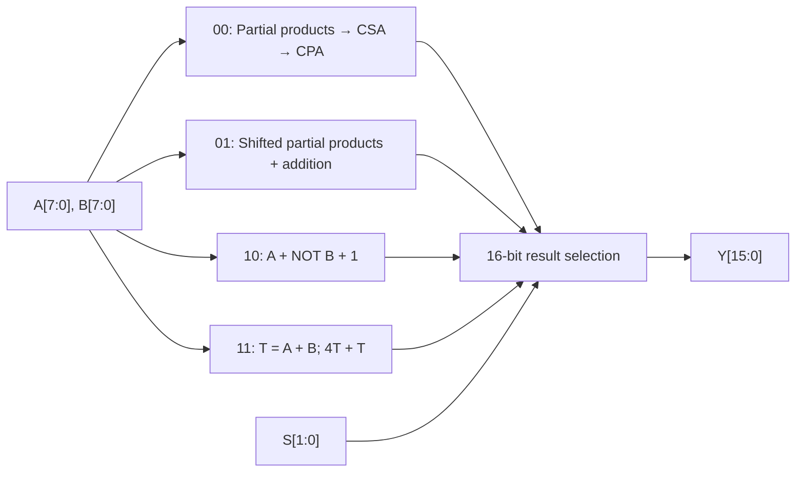
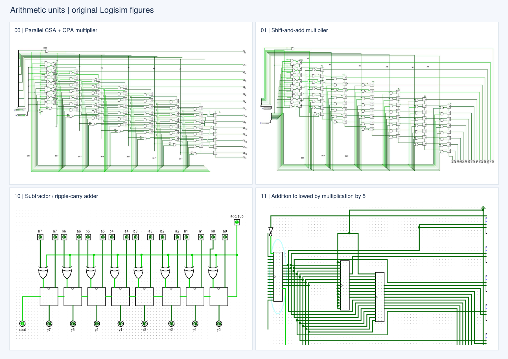
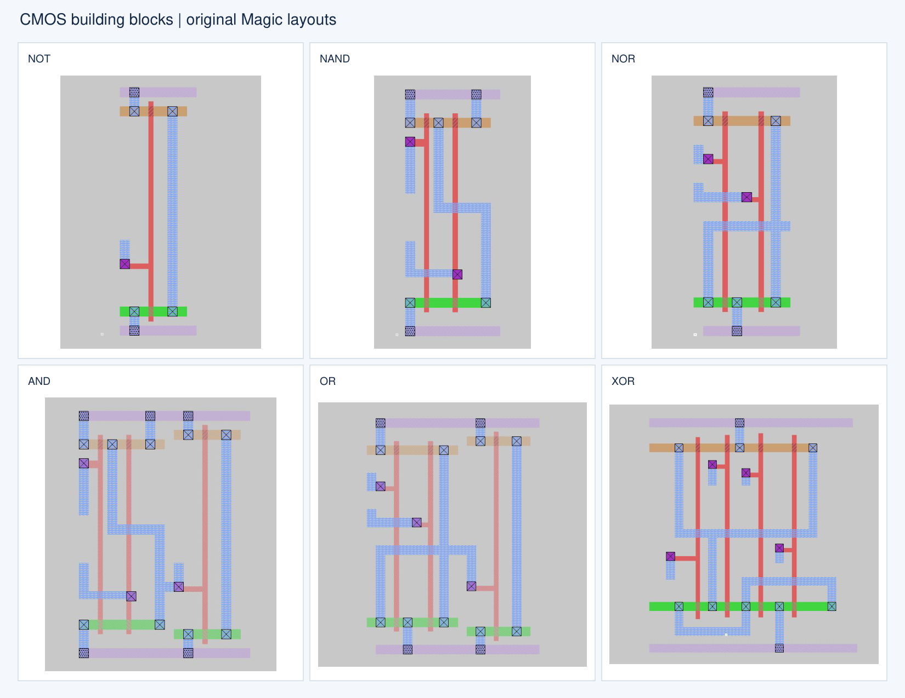
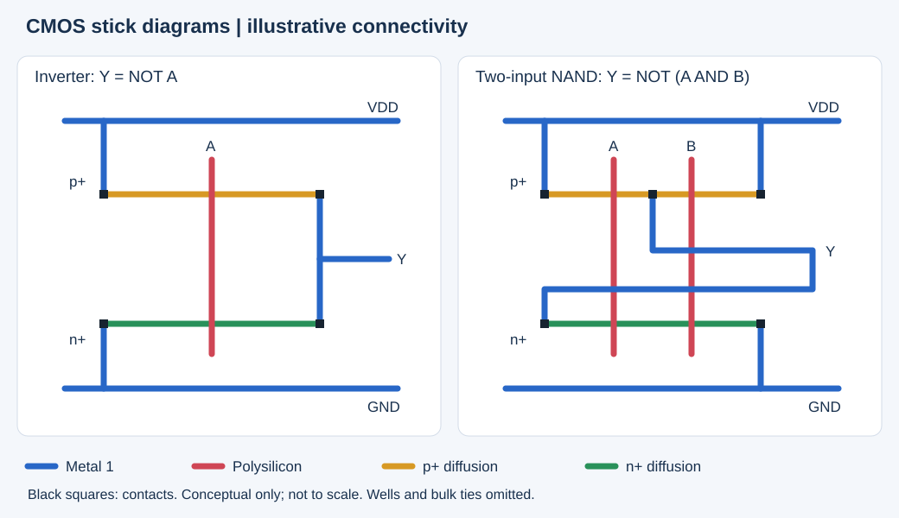

# 8-bit CMOS Arithmetic Unit

A course project that takes an arithmetic unit from digital logic design in Logisim to hierarchical CMOS layout in Magic and switch-level simulation in IRSIM. Two 8-bit operands feed four selectable arithmetic paths, with a shared 16-bit output.

**Talal Aloushan · December 2023**  
**CEN415 — Introduction to VLSI Design**  
Computer Engineering Department, College of Computer and Information Sciences, **King Saud University**  
Supervised by **Dr. Ayed Al-Qahtani**

Team: Talal Aloushan, Abdulrahman Almalek, Fahad Aljabr, and Bader Alsabti. This repository presents the team's course project; the report does not assign individual component ownership.

## Overview

| Selector `s1 s0` | Output operation | Arithmetic path |
|:---:|---|---|
| `00` | `A × B` | Parallel carry-save addition (CSA) followed by carry-propagate addition (CPA) |
| `01` | `A × B` | Shift-and-add multiplication |
| `10` | `A − B` | Two's-complement subtraction |
| `11` | `5 × (A + B)` | Ripple-carry addition and constant multiplication |

The interface includes `A[7:0]`, `B[7:0]`, `S[1:0]`, `Y[15:0]`, a carry output, and common VDD/GND. These selector values choose combinational operations; they are not clocked controller states. The assignment specifies nMOS `W = 4λ, L = 2λ` and pMOS `W = 8λ, L = 2λ`.

## Results

The original report documents the integrated Logisim circuit, the Magic layout, and IRSIM waveforms. Its Logisim examples cover all four operations:

| Operation | Report example | Expected arithmetic result | Evidence |
|---|---|---:|---|
| CSA/CPA multiplication | `7 × 7` | 49 | Report, p. 10 |
| Shift-and-add multiplication | `7 × 7` | 49 | Report, p. 11 |
| Subtraction | `7 − 7` | 0 | Report, p. 12 |
| Addition and multiplication by five | `5 × (3 + 5)` | 40 | Report, p. 13 |

These are documented sample demonstrations, not an exhaustive correctness or timing characterization. The retained IRSIM commands provide additional input stimuli. No new simulation, DRC, LVS, area, power, or delay measurements are claimed here.

<strong>Main figures — integrated logic, physical layout, and simulation</strong>

### Integrated Logisim design

Original project report, p. 4, Figure 1. The same integrated circuit view also appears among the report's sample tests.

### Final Magic layout

Original project report, p. 22. Arithmetic cells and output multiplexers are brought together in `mainp/Final.mag`.

### IRSIM waveform

Original project report, p. 22. This preserves the submitted simulation capture at its original image resolution.

## Approach

The design combines arithmetic units built from full adders and logic gates, then selects the appropriate output with a bank of 4:1 multiplexers. Each 4:1 multiplexer is composed of three 2:1 multiplexers. The physical hierarchy includes inverter, NAND, NOR, AND, OR, XOR, full-adder, and multiplexer cells.

<strong>Architecture — the four operation paths</strong>

This diagram summarizes the intended operations. It is documentation added for this repository, rather than an extracted netlist or proof of the physical implementation.

### `00` — parallel CSA and CPA multiplication

An 8 × 8 unsigned product starts with 64 bitwise AND partial products. Carry-save addition combines partial-product rows without propagating a carry across the entire word at each reduction stage. A final carry-propagate addition produces the binary product. The retained `CSA and CPA.circ` contains 64 AND gates and 56 adder components.

### `01` — shift-and-add multiplication

The product is the sum of shifted copies of A selected by the bits of B: `A × B = Σ bᵢ(A << i)`. The report shows a combinational array of gates and adders, rather than a clocked iterative multiplier with a controller. The original standalone Logisim dependency for this path is not included in this archive; the report figure and Magic/IRSIM files are retained.

### `10` — subtraction

Two's-complement subtraction uses `A + (~B) + 1`. The report's shared add/subtract building block uses XOR gates to conditionally invert B and an adder carry-in to supply the extra one. The arithmetic core is eight bits wide; interpreting a negative result requires attention to the output extension and carry/borrow convention. The documented `7 − 7` example does not establish all negative-result cases.

### `11` — addition and multiplication by five

A ripple-carry adder first forms `T = A + B`, then constant multiplication follows `5T = (T << 2) + T`. Correct full-range unsigned arithmetic needs the ninth sum bit because `A + B` can reach 510; the maximum final result is 2550. These are arithmetic width requirements, not newly verified boundary-test results for the preserved circuit.

Original project report, pp. 5–8, assembled into a single figure. The diagrams retain their original screenshot detail.

**Archive limitation:** `csacpamultiplier.mag` and `shiftaddmultiply.mag` are byte-identical, as are their `.ext` files. Their distinct names are both referenced by `Final.mag`, so both are retained. The layout archive alone therefore does not demonstrate two different multiplier architectures. The corresponding `.sim` files differ; they have not been regenerated or reconciled.

<strong>CMOS building blocks — layouts and illustrative stick diagrams</strong>

Original gate layouts from `gates_layout/`, also reproduced in the report's section titled “Stick diagram.” Those figures show physical layout geometry.

The stick diagrams above were added as conceptual explanations for this repository. They show layer connectivity for representative static CMOS gates; they are not submitted project artifacts or reconstructions of the exact Magic geometry. They omit wells and bulk ties and are not drawn to scale. Metal crossings connect only at explicitly marked contacts; polysilicon crossing diffusion represents a transistor.

For textbook context, see Weste and Harris, *CMOS VLSI Design*, 4th edition, Chapter 1, §1.5.5 and Figure 1.43, available through the [authors' course material](https://pages.hmc.edu/harris/cmosvlsi/4e/cmosvlsidesign_4e_ch1.pdf). That figure illustrates inverter and three-input NAND stick diagrams. The two-input NAND illustration here is an original explanatory drawing; no textbook figure is redistributed.

## Dataset and verification inputs

This is a circuit-design project and uses **no external dataset**. Its verification inputs are binary operand/selector test vectors, with schematic screenshots and switch-level waveforms as evidence.

`mainp/Final.cmd` sets a 50-unit simulation step and applies `(A, B) = (4, 2)` and `(8, 4)` while switching between selector `11` and `10`. The expected arithmetic results are respectively 30/2 and 60/4. This script does not select either multiplication path. Separate commands are retained for subtraction, the 8-bit adder, and addition followed by multiplication by five. These scripts supply stimuli and display signals; they do not contain automatic pass/fail assertions.

## Project files

| Path | Contents |
|---|---|
| [`Logisim/VLSIPROJ.circ`](Logisim/VLSIPROJ.circ) | Most complete retained integration: two multiplier connections, add/subtract logic, and output selection |
| [`Logisim/CSA and CPA.circ`](Logisim/CSA%20and%20CPA.circ) | Relative library dependency used by the integrated project |
| [`Logisim/csa.circ`](Logisim/csa.circ) | Separate multiplier schematic with different wiring and bus interfaces; retained because it is not a duplicate |
| [`mainp/`](mainp/) | Original Magic `.mag` layouts, `.ext` extraction snapshots, IRSIM `.sim` netlists, and `.cmd` stimuli; top level is `Final.mag` |
| [`gates_layout/`](gates_layout/) | Original individual gate layout images |
| [`docs/VLSI451Report.pdf`](docs/VLSI451Report.pdf) | Full project report and original results |
| [`docs/VLSI451Report.docx`](docs/VLSI451Report.docx) | Editable report source |
| [`docs/assignment.pdf`](docs/assignment.pdf) | Original project specification |
| [`assets/`](assets/) | README figures extracted from project material and one explanatory SVG |

The integrated Logisim project retains its original reference to `ShiftnAdd.circ`, which is unavailable. No replacement circuit has been invented. The existing source and reports are preserved byte-for-byte.

<strong>Archive selection and reproduction notes</strong>

`VLSIPROJ.circ` was selected as the most complete integration by inspecting its circuit hierarchy and external component instances. `VLSIPROJ (1).circ` has one external multiplier instance and an absolute library path; `VLSIPROJ (2).circ` has neither external multiplier instance. Those earlier integrations are omitted from this repository copy. The separate `csa.circ` has 836 wires and bus-oriented pins, compared with 689 wires in `CSA and CPA.circ`, so it is retained as a distinct design.

The interim `sys (1).docx` repeats the testing material incorporated into the final report. It and the general environment/tutorial PDFs are omitted to keep this repository focused on project work. The original working folder is unchanged. Layout snapshots are retained, including similarly named cells, to preserve the physical-design archive.

The report records the original entry points as `magic Final` and `irsim scmos100.prm Final.sim -Final.cmd`, run inside `mainp/` with the required tools and technology parameter file installed. See the report for the full original testing walkthrough. Opening the Logisim integration requires resolving the missing shift-and-add library; no circuit source was edited during repository preparation.

