# 8-bit CMOS Arithmetic Unit

**Talal Aloushan · December 2023 · CEN415 - Introduction to VLSI Design**  

A VLSI course project implementing an arithmetic unit with two 8-bit inputs, a 2-bit selector, and a 16-bit output. The work spans digital logic design in Logisim, hierarchical CMOS layout in Magic, and switch-level simulation in IRSIM. Four arithmetic paths combine multiplication(parallel CSA & CPA), subtraction, and addition with constant multiplication, using full adders, CMOS gates, and multiplexers.

## Problem

Implement a system that performs the operations in the table:

<table>
<thead>
<tr><th colspan="2">Operation code</th><th rowspan="2">Operation (Y)</th><th rowspan="2">Description</th></tr>
<tr><th>s1</th><th>s0</th></tr>
</thead>
<tbody>
<tr><td>0</td><td>0</td><td>A * B</td><td>Multiply A by B using parallel CSA and CPA</td></tr>
<tr><td>0</td><td>1</td><td>A * B</td><td>Multiply A by B using shift and add.</td></tr>
<tr><td>1</td><td>0</td><td>A - B</td><td>Simple subtraction</td></tr>
<tr><td>1</td><td>1</td><td>5 * (A+B)</td><td>Multiply the addition result by 5</td></tr>
</tbody>
</table>

Inputs: `A[7:0]`, `B[7:0]`, `S[1:0]`, VDD and GND. Outputs: `Y[15:0]` and a possible carry-out. Device dimensions: nMOS `W = 4λ, L = 2λ`; pMOS `W = 8λ, L = 2λ`.

## Results

| Operation | Example | Expected result |
|---|---|---:|
| Parallel CSA/CPA multiplication | `7 × 7` | 49 |
| Shift-and-add multiplication | `7 × 7` | 49 |
| Subtraction | `7 − 7` | 0 |
| Addition followed by multiplication by five | `5 × (3 + 5)` | 40 |

<strong>Integrated design and simulation</strong>

| Logisim | Magic layout |
|:---:|:---:|
| 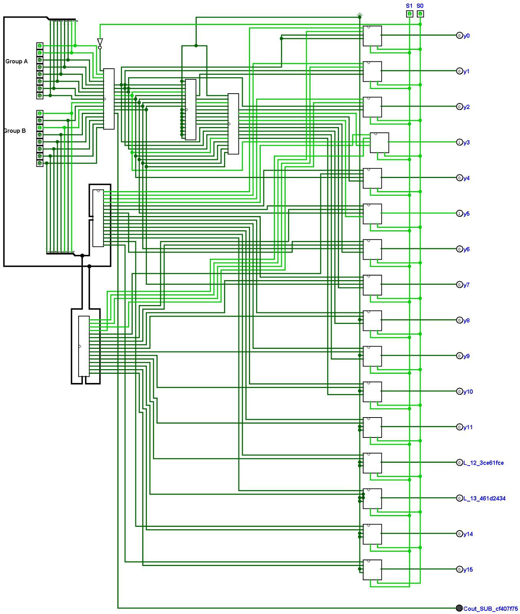 | 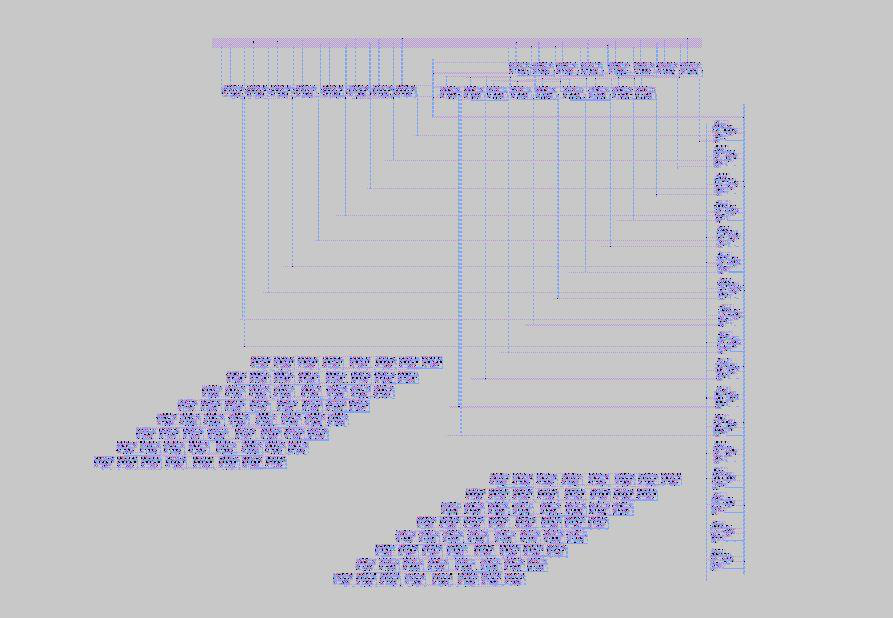 |

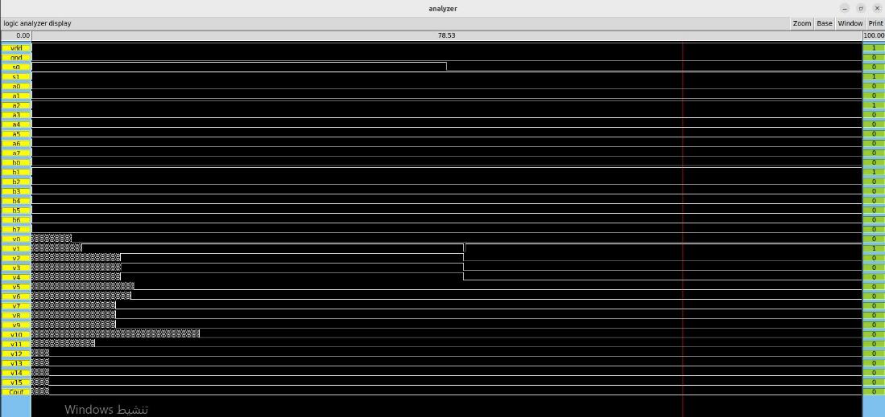

## Approach

Arithmetic units feed a bank of 4:1 output multiplexers. Full adders and basic CMOS gates form the reusable building blocks.

<strong>00 — Parallel CSA and CPA multiplication</strong>

AND gates form partial products; carry-save stages reduce them before a final carry-propagate addition.

| Logisim | Magic layout |
|:---:|:---:|
| 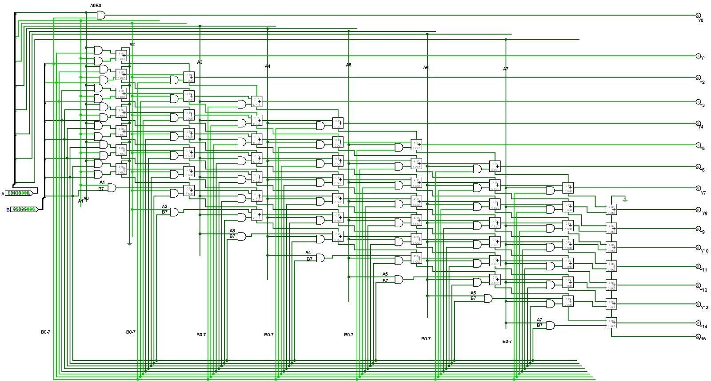 | 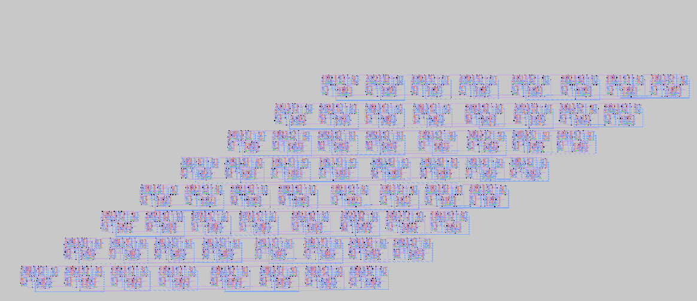 |

<strong>01 — Shift-and-add multiplication</strong>

Shifted partial products are accumulated through the combinational adder network.

| Logisim | Magic layout |
|:---:|:---:|
| 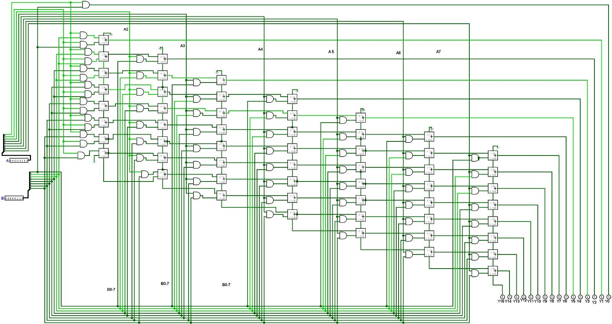 |  |

<strong>10 — Subtraction</strong>

The add/subtract unit uses conditional inversion and carry-in to implement `A + (~B) + 1`.

| Logisim | Magic layout |
|:---:|:---:|
| 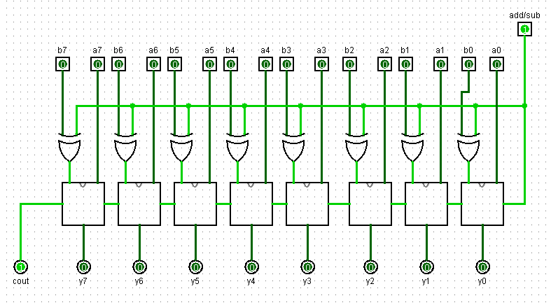 | 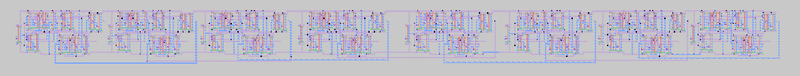 |

<strong>11 — Addition followed by multiplication by five</strong>

A ripple-carry adder forms `T = A + B`; constant multiplication follows `5T = (T << 2) + T`.

| Logisim | Magic layout |
|:---:|:---:|
| 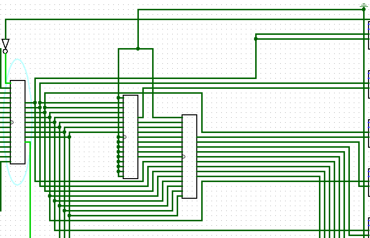 | 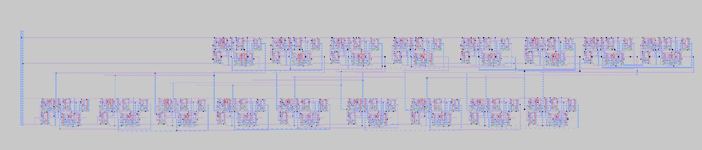 |

<strong>CMOS gate layouts</strong>

| NOT | NAND | NOR |
|:---:|:---:|:---:|
| 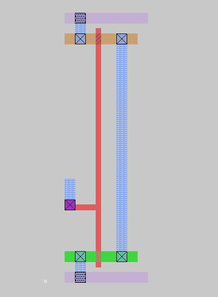 | 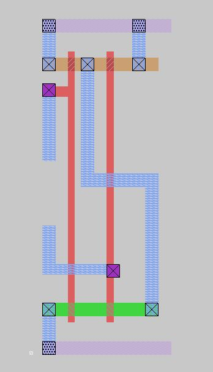 | 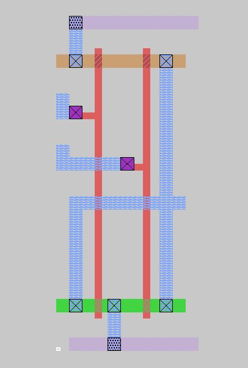 |
| **AND** | **OR** | **XOR** |
| 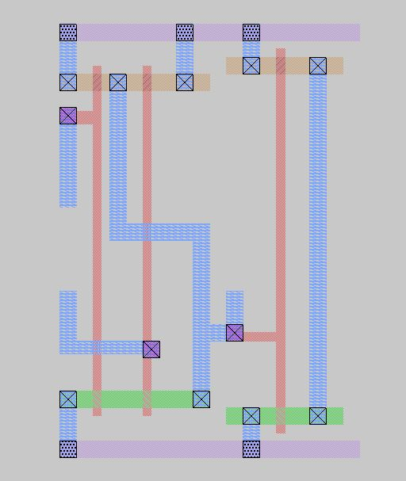 | 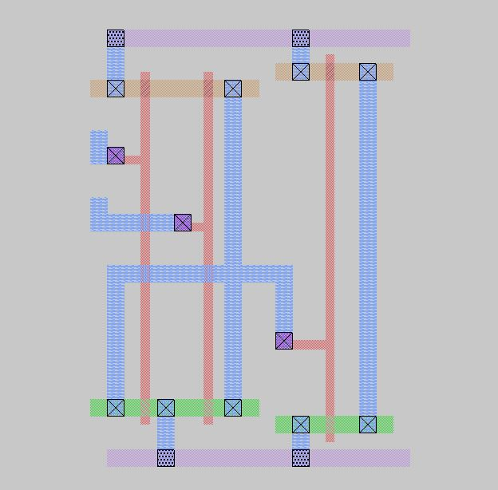 | 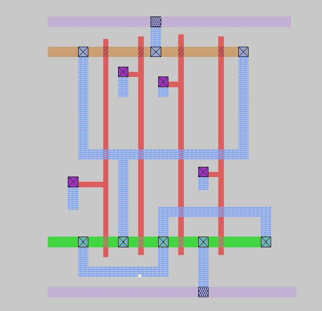 |
| **4:1 MUX** | | |
| 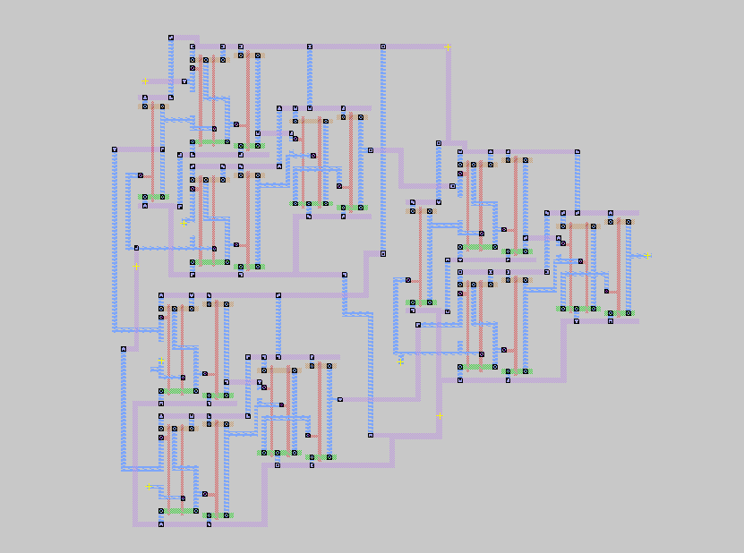 | | |

## Project files

| Path | Contents |
|---|---|
| [`Logisim/`](Logisim/) | Integrated `VLSIPROJ.circ`, CSA/CPA library, and separate `csa.circ` schematic |
| [`mainp/`](mainp/) | Magic layouts, extraction files, IRSIM netlists and test commands; top level: `Final.mag` |
| [`gates_layout/`](gates_layout/) | gate layout images |
| [`docs/VLSI451Report.pdf`](docs/VLSI451Report.pdf) · [Word source](docs/VLSI451Report.docx) | Project report and results |
| [`docs/assignment.pdf`](docs/assignment.pdf) | Original problem statement |
| [`docs/Magic-irsim-tutorial.pdf`](docs/Magic-irsim-tutorial.pdf) | Magic and IRSIM tutorial |
| [`docs/Preparing-Project-Environment.pdf`](docs/Preparing-Project-Environment.pdf) | Project environment guide |
| [`assets/`](assets/) | Individual README figures |
